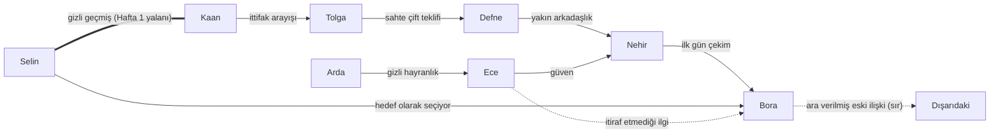

# Karakterler (taslak v0.1)

Mekân: Alanya'da bir yaz villası (bkz. [Açık sorular ve öneriler](07-acik-sorular-oneriler.md)).
8 başlangıç karakteri + 2. hafta sonunda 1 yeni gelen.

## Kurallar
- Tüm karakterler kurgusal. İsim, meslek, şehir ve görünüş **gerçek bir yarışmacıyla
  eşleşmemeli**. Yayından önce isimleri esin kaynağı programların yarışmacı listeleriyle
  karşılaştır; çakışan ismi değiştir.
- Her karakterin bir **görünen yüzü**, bir **gerçek motivasyonu** ve bir **sırrı** var.
  "Kötü" davranışın arkasında anlaşılır bir neden olmalı.
- Hakaret, aşağılama, şiddet yok. Şehir/meslek üzerinden kalıp yargı espri malzemesi değil.

## Karakter kartları

### Nehir · 25 · İzmir · Seramik sanatçısı
- **Görünen:** Sıcak, dürüst, biraz saf.
- **Gerçek:** Sanıldığından çok daha iyi gözlemci; kolay kandırılmaz ama bunu belli etmez.
- **Sır:** Hiç ciddi bir ilişki yaşamadı, bunu "deneyimsiz görünmemek" için saklıyor.
- **Drama rolü:** Aşk üçgeninin "kalp" tarafı · ikinci şans
- **Kanca repliği tarzı:** Kısa, içten cümleler. "Bana yalan söyleme, yeter."

### Bora · 28 · Bodrum · Yelken eğitmeni
- **Görünen:** Karizmatik, rahat, herkesle iyi.
- **Gerçek:** Kararsız; kimseyi kırmamak için herkese biraz umut veriyor. Reddetmekten korkuyor.
- **Sır:** Villaya gelmeden önceki ilişkisi bitmedi, "ara verdik" dedikleri bir ayrılık.
- **Drama rolü:** Aşk üçgeninin merkezi · kıskançlık tetikleyicisi
- **Kanca repliği tarzı:** Belirsiz cümleler. "Bakarız, acele etmeyelim."

### Selin · 27 · Ankara · Avukat
- **Görünen:** Soğuk, net, stratejik.
- **Gerçek:** Geçmişte aldatılmış; önce hamle yapmazsa kaybedeceğine inanıyor. Sertliği bir kalkan.
- **Sır (Hafta 1 yalanı):** Kaan'la 3 yıl önce kısa bir ilişki yaşadı. Girişte "burada kimseyi tanımıyorum" dedi.
- **Drama rolü:** Aşk üçgeninin stratejik tarafı · geçmişten tanışıklık · oylamada ihanet
- **Kanca repliği tarzı:** Kesin ve kısa. "Ben beklemem."

### Kaan · 31 · Trabzon · Balık restoranı işletmecisi
- **Görünen:** Ağabey, arabulucu, herkesin sırdaşı.
- **Gerçek:** Selin'e hâlâ kırgın. Arabuluculuğu evde kontrolü elinde tutmak için kullanıyor.
- **Sır:** Selin'le geçmişini biliyor ama o açıklamadıkça susuyor; bu bilgiyi doğru anda kullanmayı bekliyor.
- **Drama rolü:** Geçmişten tanışıklık · ittifak kurucu · ittifak ve bölünme
- **Kanca repliği tarzı:** Sakin, imalı. "Herkesin bir hikâyesi var, değil mi Selin?"

### Defne · 24 · Eskişehir · Podcast yapımcısı
- **Görünen:** Neşeli, herkesle arkadaş, evin enerjisi.
- **Gerçek:** Görünür olmak ve hikâyenin içinde olmak istiyor. Kötü niyetli değil ama duyduğunu süsleyerek anlatıyor.
- **Sır:** Villaya, kendi podcast'i için "malzeme toplamak" niyetiyle geldi.
- **Drama rolü:** Yanlış anlaşılan dedikodu · gizli konuşma ifşası
- **Kanca repliği tarzı:** Heyecanlı. "Durun durun, size bir şey anlatmam lazım!"

### Arda · 26 · Kaş · Dalış eğitmeni
- **Görünen:** Sessiz, mesafeli.
- **Gerçek:** Romantik ve utangaç; ilk günden Ece'den hoşlanıyor ama söyleyemiyor.
- **Sır:** Günlüğüne (izleyiciye) her gün Ece'ye yazıp göndermediği notlar yazıyor.
- **Drama rolü:** İtiraf anı (izleyici bilir, karakterler bilmez) · ikinci şans
- **Kanca repliği tarzı:** Az ve derin. "Bazı şeyler söylenince bozuluyor."

### Ece · 29 · Bursa · Acil servis hemşiresi
- **Görünen:** Dobra, sert sözlü, sabırsız.
- **Gerçek:** Yalana tahammülü yok çünkü kardeşinin yalanları yüzünden ailesi çok yıprandı. Altında kırılgan biri var.
- **Sır:** Bora'dan etkilendiğini kendine bile itiraf etmiyor.
- **Drama rolü:** Kıskançlık krizi · oylamada vicdan sesi
- **Kanca repliği tarzı:** Direkt. "Yüzüme söyle."

### Tolga · 30 · İstanbul · Emlak danışmanı
- **Görünen:** Esprili, çekici, ortamı yumuşatan.
- **Gerçek:** Hayatı boyunca "her şeyi yarım bırakan" olarak görülmüş; bu sefer sonuna kadar kalmaya kararlı. Bunun için ittifak ve gerekirse sahte çift kurar.
- **Sır:** Defne'ye "çift gibi görünelim, ikimiz de güvende oluruz" teklifi yapacak (Hafta 1).
- **Drama rolü:** Stratejik/sahte çift · ittifak ve bölünme
- **Kanca repliği tarzı:** Şakayla karışık ciddi. "Oyun değil bu, ama kurallarını bilmek lazım."

### Yeni gelen (Hafta 2 sonu) · Lara · 27 · Berlin'den dönmüş ses mühendisi
- **Görünen:** Rahat, özgüvenli, dışarıdan gelen "taze kan".
- **Gerçek:** Herkesin onu tehdit olarak göreceğini biliyor; önce dinleyip sonra konuşmayı seçiyor.
- **Sır:** Villaya bir **sır kartıyla** giriyor: izleyicinin seçtiği bir sırrı biliyor (bkz. ana mekanik önerisi).
- **Drama rolü:** Yeni gelen · çift dengesini bozan

## İlişki haritası (başlangıç)

### Ana gerilim hatları (ilk 2 hafta)
1. **Aşk üçgeni:** Nehir ↔ Bora ↔ Selin (Ece arka planda dördüncü köşe olma potansiyeli taşıyor).
2. **Geçmiş sırrı:** Selin ↔ Kaan. Haftanın "kim yalan söylüyor?" sorusu.
3. **Sahte çift:** Tolga + Defne. Defne'nin dedikodu alışkanlığı sahte çifti ifşa riski taşıyor.
4. **İtiraf anı:** Arda → Ece. İzleyici biliyor, Ece bilmiyor.

## Oyun için başlangıç değerleri (hikâye modu)

Her ikili için iki değer: **Güven** (0-100) ve **İlgi** (0-100). Oyuncu seçimleri bu değerleri
değiştirir; oylama sonuçları ve çift olma bu değerlere göre hesaplanır.

| İkili | Güven | İlgi | Not |
|-------|-------|------|-----|
| Nehir → Bora | 55 | 70 | |
| Bora → Nehir | 50 | 60 | |
| Bora → Selin | 45 | 55 | |
| Selin → Bora | 30 | 50 | İlgi stratejik |
| Selin → Kaan | 20 | 15 | Gizli geçmiş |
| Kaan → Selin | 25 | 30 | Kırgınlık |
| Arda → Ece | 50 | 80 | Gizli |
| Ece → Arda | 40 | 25 | |
| Ece → Bora | 35 | 45 | Bastırılmış |
| Tolga → Defne | 50 | 30 | Stratejik |
| Defne → Tolga | 55 | 35 | |
| Defne → Nehir | 70 | — | Arkadaşlık |
| Kaan → Tolga | 50 | — | İttifak |

> Hikâye modunda oyuncunun hangi karakter olacağı açık soru. Öneri: MVP'de oyuncu
> **9. kişi olarak eve giren özelleştirilebilir bir karakter** ("Sen"); böylece yukarıdaki
> 8 karakter Instagram dizisinden oyuna aynen taşınır.
